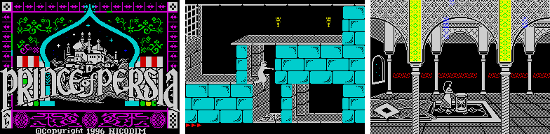

# Prince of Persia — ZX Spectrum 128 (Nicodim, 1996) — source code

Buildable source code of the 1996 ZX Spectrum 128K / TR-DOS port of *Prince of Persia*
by Nicodim, recovered from the author's own disks (TASM 3.x sources) and converted to
[sjasmplus](https://github.com/z00m128/sjasmplus). Copy protection is removed, all disk
access goes through one small driver, graphics can be exported to PNG and imported back.
`python build.py` produces a bootable `.trd` image. Documentation below is in Russian.

---

Исходные тексты порта *Prince of Persia* для ZX Spectrum 128K / TR-DOS (Nicodim, 1996),
восстановленные с авторских дисков и приведённые к виду, который собирается
sjasmplus и удобен для правок, модов и портирования:

* защита снята;
* вся работа с диском — в одном маленьком драйвере;
* 13 копий движка (по одной на уровень) слиты в один исходник;
* графика выгружается в PNG и собирается обратно;
* сборка одной командой даёт загружаемый образ `.trd`.

## Сборка

Нужны Python 3 и `sjasmplus` в PATH (или переменная окружения `SJASMPLUS`);
для работы с графикой — Pillow (`pip install pillow`).

    python build.py            # -> build/prince.trd
    python build.py --list     # + листинги в build/lst/

Образ — обычный диск TR-DOS (80 дорожек, 2 стороны), запускается на Pentagon/Scorpion
128K и в эмуляторах. Управление: Q/A/O/P/Space или Sinclair. В меню: вправо — игра,
влево — ввод пароля. Пароль уровня: `python tools/password.py <уровень 2..12> [минут] [жизней]`.

## Состав

| Путь | Что это |
|---|---|
| `src/` | рабочие исходники — их и нужно править |
| `src/disk.inc` | интерфейс дискового слоя и карта диска |
| `src/disk_io.asm` | драйвер диска: единственный модуль, знающий про TR-DOS |
| `src/boot.asm` | загрузчик |
| `src/kernel.asm` | резидентное ядро #61A8..#7273 (оригинал BLOCK2) |
| `src/game.asm`, `game_part.asm` | движок игры; отличия уровней под `IF LVL` |
| `src/levels/levelNN.asm` | таблицы и карта уровня (ASCII) |
| `src/menu*.asm`, `demo*.asm`, `ending*.asm` | меню с вводом пароля, демо-режим, финал |
| `src/intro.asm` | заставка: бинарник + пересобранные обращения к диску |
| `res/` | графика, музыка и блоки без исходников (из мастер-диска) |
| `gfx/` | графика в PNG (экспорт из `res/`) |
| `original_src/` | авторские тексты в синтаксисе sjasmplus, как есть, с защитой |
| `orig/` | четыре исходных образа TRD |
| `tools/` | детокенизатор TASM, сверка, графика, пароли, прогон в эмуляторе |
| `build.py` | сборка |

## Как устроена игра

Игра — набор отдельных программ, которые по очереди грузятся в одно и то же место:

    загрузчик -> заставка -> демо <-> меню -> уровень 1 -> ... -> уровень 13 -> финал

* **Ядро** (25000, `kernel.asm`) загружается один раз и остаётся в памяти: вывод
  спрайтов, клавиатура, таймер, решётки, лезвия, зелья, печать текста.
* **Программа** (29300): меню, демо, уровень или финал. Каждый уровень — отдельная
  программа: движок + карта. В `game.asm` код, общий для всех уровней, идёт как есть,
  а отличия заключены в `IF LVL == n`; собирается 13 раз с `-DLVL=n`.
* «Уровень 13» — вторая половина 12-го (в игре подписан LEVEL 12, пароля на него нет).
* Между некоторыми уровнями грузится заставка (39000).

Память:

    #5E00  драйвер диска             #61A8  ядро
    29300  программа                 39000  межуровневая заставка
    39450  пламя факела (9 кадров)   39600  карта уровня
    #B800  буферы BUF/ROOM/ROTT
    #C000  страницы 128K: 16 — тайлы и код их отрисовки (#D800), 17 и 22 — спрайты
           принца, 19 — враги, решётки, лезвия, 20 — музыка, 23 — рабочая копия карты

Ядро нельзя сдвигать: код отрисовки внутри `res/tiles*.bin` (без исходника) вызывает
его по абсолютным адресам, а программы начинаются сразу за ним. В ядре стоят ASSERT.
Адреса ядра программы получают автоматически: `kernel.asm` экспортирует их
(`kernel_exports.inc`), сборка пишет `build/obj/kernel_api.inc`.

Карта уровня — текст: `@` стена, `_` пол, `I` колонна, `#` решётка, `!` шипы,
буквы — кнопки и связанные с ними решётки; рядом таблицы решёток, зелий, врагов,
факелов (`src/levels/`).

## Дисковый слой

Всё, включая заставку, читает диск только через драйвер (`src/disk_io.asm`):

    DSK_INIT            ; один раз из загрузчика
    DSK_READ            ; HL = адрес, DE = идентификатор блока (D_xxx), B = длина в секторах по 256 байт

Для TR-DOS идентификатор блока — дорожка и сектор; карта диска — `src/disk.inc`,
по ней же `build.py` раскладывает блоки (раскладка повторяет мастер-диск). Каждый блок
дополнительно внесён в каталог как файл, но игра каталог не читает. Записи на диск нет.

Чтобы перенести игру на другую дисковую систему, нужно заменить `disk_io.asm`,
`boot.asm` и функцию сборки образа в `build.py`; `D_xxx` при этом может означать что
угодно (номер блока, индекс файла). Под драйвер свободно #5E00..#60FF.

## Графика

    python tools/gfx.py list                      # что где лежит и в каком формате
    python tools/gfx.py export                    # res/*.bin -> gfx/*.png
    python tools/gfx.py import                    # gfx/*.png -> res/*.bin

Альтернативный набор рядом с оригинальным:

    python tools/gfx.py export --gfx gfx_new      # править gfx_new/*.png
    python tools/gfx.py import --gfx gfx_new --out res_new
    python build.py --res res_new --out build/prince_new.trd

Листы — сетка ячеек с синими разделителями (размер листа менять нельзя). Белый — точка,
чёрный — фон; в листах с маской пурпурный — прозрачно. Экспорт и импорт без правок дают
те же байты. Форматы:

* спрайты принца и врагов — 40×42, 210 байт, без маски (обводку рисует игра); номера
  0..77 `prince`, 78..155 `prince1`, 156.. — набор врагов уровня (`prince2*`);
* `high` — 24×55 (вис, подтягивание); `*_long` — 56×38 (длинный прыжок, фехтование);
* тайлы `tiles` (подземелье) и `tilesa` (дворец): стена, окно, колонна, пол — 56 точек
  шириной, пары байт «рисунок, маска»; решётка; маски перекрытия спрайтов;
* лезвия, зеркало, дверь выхода, пламя факела, шрифт финала, экран загрузки.

Цвета комнат задаются кодом, а не графикой. Не разобраны спрайты финала
(`endfile.bin`) и картинки заставок.

## Откуда это и насколько это точно

В `orig/` — четыре образа с дисков автора: мастер-диск игры, два диска с исходниками
(«archive» и «compile») и диск форматтера. Исходники хранились в токенизированном
формате ассемблера TASM 3.x.

1. `tools/trdextract.py`, `tools/detok.py`, `tools/convert.py` — извлечение файлов,
   детокенизация и минимальная правка синтаксиса. Результат — `original_src/`
   (плюс несколько ручных правок опечаток, которые TASM прощал).
2. `python tools/verify_original.py` собирает `original_src/` и сравнивает с
   расшифрованным мастер-диском. Ядро, все 13 уровней, меню, демо и финал совпадают
   байт в байт во всём, что определено исходником. Исключения — 1 байт в уровне 13 и
   4 байта в меню: исходники чуть старше мастер-диска.
3. `tools/make_src.py` один раз породил `src/`: снял защиту, заменил адреса диска
   символами, слил 13 копий движка. `python tools/verify_merge.py` проверяет, что слитый
   исходник разворачивается обратно в 13 исходных. Дальше `src/` правится руками —
   повторный запуск `make_src.py` затрёт правки.

Отличия `src/` от авторских исходников по поведению — три места, взятые с
мастер-диска: `LD IX,STL+10` в уровне 13, позиции уровней 7 и 8 в меню, запись клавиш
демо-режима (на диске есть, в исходнике нет).

Снятая защита: XOR-расшифровщики на регистре R в начале каждой программы и заставки
и проверка «сырой» дорожки (поиск метки `A1 A1 FB 18 nn AA`) в загрузчике, уровнях,
демо, меню и финале.

Проверено в эмуляторе ZX-M8XXX (Pentagon 128): заставка, меню,
уровень 1, вход по паролю на уровни 2–12, загрузка «уровня 13» и программы финала.
Полное прохождение не проверялось.

## Чего нет в исходниках

Эти части взяты бинарниками с мастер-диска (`res/`):

* заставка с Pro Tracker-музыкой (`intro.bin`, код с 32000);
* четыре межуровневые заставки (`cut1..4.bin`, грузятся в 39000);
* код отрисовки комнаты внутри `tiles.bin` / `tilesa.bin` (#FA64.. — PUTROOM,
  PUTITEM, PUTMASK);
* плееры и музыка (`music.bin`, `omusic.bin`).

В сборку не вошли, но лежат в `original_src/archive`: BLOCK1 (отладочное ядро с
загрузкой файлов по имени), RUN, PROT (защищённый загрузчик), а в
`original_src/compile` — ENDGAME (отладочный вариант финала).

Комментариев в коде движка почти нет — метки и структура авторские.

## Проверка в эмуляторе

    python tools/emu/run_emu.py play name=boot steps=F700,KSpace,F500,Dp,F250,Up,F900,S

Нужны эмулятор ZX-M8XXX (путь — в переменной `M8XXX_DIR`) и Chrome; сценарий задаётся
шагами (`F` — кадры, `K`/`D`/`U` — клавиши, `S` — снимок), снимки — `build/emu/<name>.png`.

## Права

*Prince of Persia* — © Jordan Mechner / Brøderbund, сейчас права принадлежат Ubisoft.
Порт для ZX Spectrum сделан Nicodim в 1996 году без лицензии. Исходные тексты и данные
игры выложены для сохранения, изучения и некоммерческих модификаций; права на них
остаются за их авторами и правообладателями.

Инструменты проекта (`build.py`, `tools/`) — под лицензией MIT, см. `LICENSE`.
